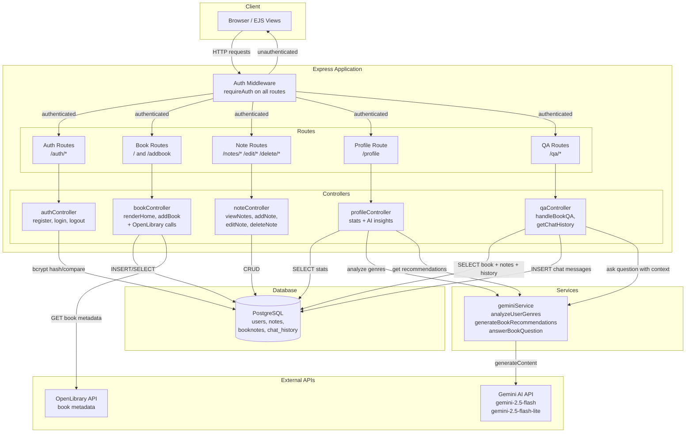
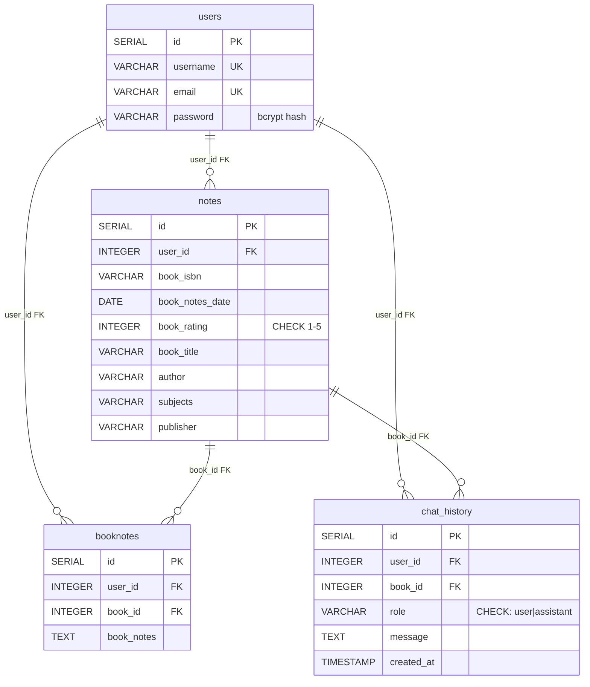
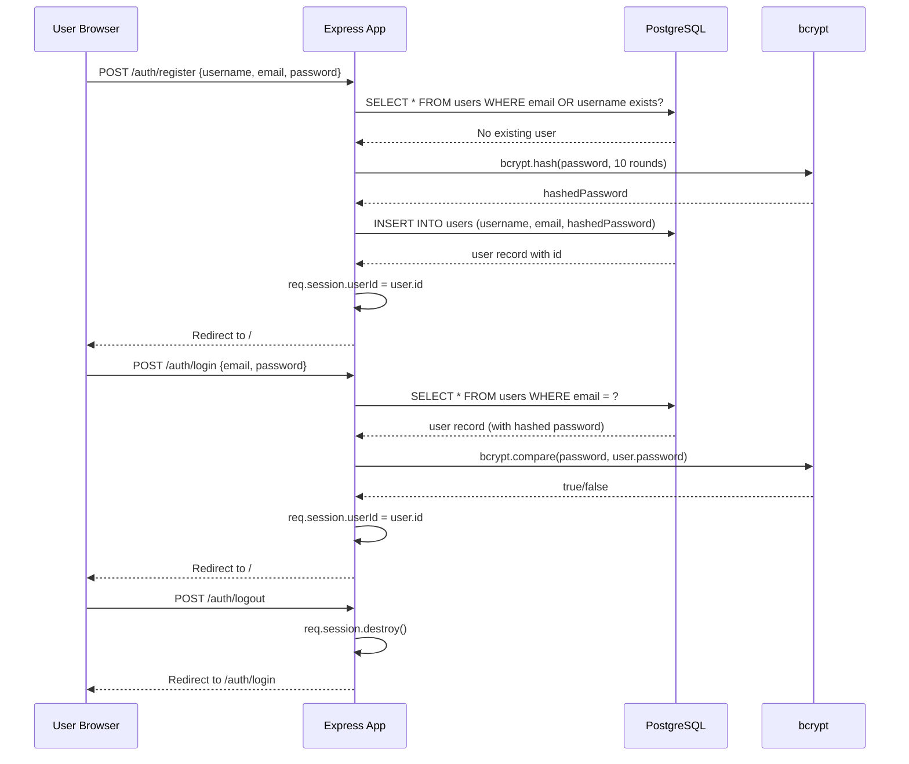

# 📚 Multi-User Book Notes Management System with AI Integration

A full-stack web application for managing your personal book collection and notes with AI-powered insights, built with Node.js, Express, PostgreSQL, and EJS using modular MVC architecture.

## Table of Contents

- [Overview](#overview)
- [Problem Statement & Motivation](#problem-statement--motivation)
- [Key Features](#key-features)
- [Technology Stack](#technology-stack)
- [Architecture Diagram](#architecture-diagram)
- [MVC Design & Layer Responsibilities](#mvc-design--layer-responsibilities)
- [Database Schema & Relationships](#database-schema--relationships)
- [Authentication & Authorization Workflow](#authentication--authorization-workflow)
- [Gemini AI Integration & Workflows](#gemini-ai-integration--workflows)
- [OpenLibrary API Integration](#openlibrary-api-integration)
- [API Routes](#api-routes)
- [Installation & Setup](#installation--setup)
- [Environment Variables](#environment-variables)
- [Running the Application](#running-the-application)
- [Screenshots](#screenshots)
- [Current Limitations & Future Improvements](#current-limitations--future-improvements)

---

## Overview

This application allows multiple users to maintain a personal library of books they've read, attach detailed notes to each book, and interact with an AI assistant that provides context-aware answers about their books. The system leverages Google's Gemini AI for genre analysis, personalized book recommendations, and conversational book Q&A with persistent chat history. Book metadata is enriched in real time via the OpenLibrary REST API.

## Problem Statement & Motivation

Readers often take scattered notes across books they read but lack a centralized system to organize those notes alongside the book metadata. Beyond storage, readers benefit from understanding their reading patterns (favorite genres, reading statistics) and getting personalized recommendations. This project solves that by combining a traditional CRUD book-notes application with AI-powered insights — genre analysis, recommendations, and a conversational Q&A interface that remembers prior context per book.

## Key Features

- **Multi-User Authentication**: Secure bcrypt-based authentication with session-based login and persistent user-specific data storage
- **Book Management**: Add books with ISBN, title, author, rating, and reading dates
- **Note Taking**: Create, edit, and delete detailed notes for each book
- **OpenLibrary Integration**: Automatically fetch book metadata including subjects, publisher info, cover images, and page counts via concurrent API calls
- **AI-Powered Insights (Gemini)**:
  - **Conversational Book Q&A**: Context-aware chat interface that remembers conversation history per book — ask follow-up questions naturally
  - **Genre Analysis**: AI analyzes your reading history to identify your top 3 favorite genres
  - **Book Recommendations**: Personalized recommendations based on identified genres and already-read books
- **User Profile**: View reading statistics (total books, total notes, average rating), AI-generated genre analysis, and personalized recommendations
- **Responsive Design**: Clean, user-friendly interface with night-light mode, built with EJS templating and Bootstrap 5

## Technology Stack

| Layer | Technology |
|-------|-----------|
| **Backend** | Node.js, Express.js (modular MVC architecture) |
| **Database** | PostgreSQL |
| **Frontend** | EJS templating engine, HTML, CSS, JavaScript, Bootstrap 5 |
| **Authentication** | bcryptjs (password hashing), express-session (session management) |
| **AI Integration** | Google Gemini AI via `@google/genai` SDK |
| **External APIs** | OpenLibrary API (book metadata), Google Gemini AI (insights) |
| **HTTP Client** | Axios (OpenLibrary API calls) |
| **Config** | dotenv (environment variable management) |

## Architecture Diagram



### Data Flow

1. **Browser → Routes**: All HTTP requests pass through `requireAuth` middleware. Unauthenticated users are redirected to `/auth/login`. Authenticated requests proceed to the appropriate route handler.

2. **Routes → Controllers**: Routes map URL patterns to controller functions. Each route file (`auth.js`, `books.js`, `notes.js`, `profile.js`, `qa.js`) defines a `requireAuth` middleware and delegates to the corresponding controller.

3. **Controllers → Database**: Controllers interact with PostgreSQL via parameterized queries (`$1`, `$2`, etc.) to prevent SQL injection. All data queries are scoped by `user_id` to ensure users only access their own data.

4. **Controllers → Services**: The `profileController` calls `geminiService` for genre analysis and recommendations. The `qaController` calls `geminiService` for conversational Q&A, passing book context and chat history.

5. **Controllers → External APIs**: The `bookController` makes concurrent HTTP requests (`Promise.all`) to the OpenLibrary API to fetch book metadata (subjects, covers, pages, publisher) for display on the home page.

## MVC Design & Layer Responsibilities

### Model Layer (Database)
- **`config/database.js`**: Creates and exports a single `pg.Client` connection to PostgreSQL, configured via environment variables.
- No separate model files — controllers query the database directly using parameterized SQL. This is a thin model approach appropriate for the app's scope.

### View Layer (`views/`)
- EJS templates that render server-side HTML.
- `home.ejs` — Main page showing all books with OpenLibrary metadata.
- `add.ejs` — Form to add a new book.
- `view.ejs` — View notes for a book + AI conversational chat interface.
- `addnote.ejs` — Form to add a note.
- `notesedit.ejs` — Form to edit a note.
- `profile.ejs` — User profile with reading stats, AI genre analysis, and recommendations.
- `auth/login.ejs`, `auth/register.ejs` — Authentication pages.

### Controller Layer (`controllers/`)
- **`authController.js`**: Handles user registration (bcrypt hashing), login (bcrypt comparison), and logout (session destruction). Checks for existing email/username before insert.
- **`bookController.js`**: Renders the home page by fetching all user books from the DB, then making concurrent OpenLibrary API calls via `Promise.all` to enrich each book with metadata (subjects, covers, pages, publisher). Handles adding new books.
- **`noteController.js`**: Full note CRUD — view notes for a book, add a note, edit a note (via PATCH), delete a note. All queries scoped by `user_id`.
- **`profileController.js`**: Aggregates reading statistics (total books, total notes, average rating), then calls `geminiService` for genre analysis and book recommendations.
- **`qaController.js`**: Handles conversational AI Q&A — retrieves book info and user notes, loads prior chat history from DB, stores the user's question, calls `geminiService.answerBookQuestion` with context and history, stores the AI response, and returns it. Also provides a `getChatHistory` endpoint.

### Service Layer (`services/`)
- **`geminiService.js`**: Encapsulates all Gemini AI interactions:
  - `analyzeUserGenres(userBooks)` — Sends book summaries (title, author, subjects, rating) to Gemini 2.5 Flash-Lite and receives the user's top 3 genres.
  - `generateBookRecommendations(favoriteGenres, userBooks)` — Asks Gemini 2.5 Flash-Lite for 2 book recommendations in JSON format, excluding already-read titles.
  - `answerBookQuestion(question, context, chatHistory)` — Builds a multi-turn conversation using Gemini 2.5 Flash with `systemInstruction` containing book metadata and user notes. Passes prior chat history as `contents` array for context-aware responses.

### Route Layer (`routes/`)
Each route file defines:
- A `requireAuth` middleware that checks `req.session.userId`.
- Route-to-controller mappings.

## Database Schema & Relationships



### Schema Setup

The `chat_history` table has a migration script. The `users`, `notes`, and `booknotes` tables must be created manually:

```sql
-- Create database
CREATE DATABASE book_notes;
\c book_notes;

-- Users table
CREATE TABLE users (
    id SERIAL PRIMARY KEY,
    username VARCHAR(255) UNIQUE NOT NULL,
    email VARCHAR(255) UNIQUE NOT NULL,
    password VARCHAR(255) NOT NULL
);

-- Books table
CREATE TABLE notes (
    id SERIAL PRIMARY KEY,
    user_id INTEGER REFERENCES users(id) ON DELETE CASCADE,
    book_isbn VARCHAR(255),
    book_notes_date DATE,
    book_rating INTEGER CHECK (book_rating >= 1 AND book_rating <= 5),
    book_title VARCHAR(255),
    author VARCHAR(255),
    subjects VARCHAR(255),
    publisher VARCHAR(255)
);

-- Individual notes table
CREATE TABLE booknotes (
    id SERIAL PRIMARY KEY,
    user_id INTEGER REFERENCES users(id) ON DELETE CASCADE,
    book_id INTEGER REFERENCES notes(id) ON DELETE CASCADE,
    book_notes TEXT
);

-- Chat history table (also available via npm run migrate)
CREATE TABLE chat_history (
    id SERIAL PRIMARY KEY,
    user_id INTEGER REFERENCES users(id) ON DELETE CASCADE,
    book_id INTEGER REFERENCES notes(id) ON DELETE CASCADE,
    role VARCHAR(20) NOT NULL CHECK (role IN ('user', 'assistant')),
    message TEXT NOT NULL,
    created_at TIMESTAMP DEFAULT CURRENT_TIMESTAMP
);

CREATE INDEX idx_chat_history_user_book ON chat_history(user_id, book_id, created_at);
```

## Authentication & Authorization Workflow



### Authorization Model

Every route (except `/auth/login` and `/auth/register`) is protected by the `requireAuth` middleware:

```javascript
function requireAuth(req, res, next) {
    if (req.session && req.session.userId) {
        return next();
    }
    res.redirect("/auth/login");
}
```

All database queries include `user_id` in their `WHERE` clause, ensuring users can only read and modify their own books, notes, and chat history. This is enforced in every controller.

## Gemini AI Integration & Workflows

The application uses the `@google/genai` SDK (v1.20+) to interact with Google Gemini AI. Three distinct AI workflows are implemented:

### 1. Genre Analysis (`analyzeUserGenres`)

- **Model**: `gemini-2.5-flash-lite` (fastest, selected for this simple classification task)
- **Input**: User's book list with titles, authors, subjects, and ratings
- **Prompt construction**: Book summaries are formatted as `"Title" by Author (subjects: ..., rating: X/5)` and passed as a list. The prompt asks Gemini to identify the top 3 genres.
- **Output**: A comma-separated string of 3 genre names (e.g., `Fiction, Mystery, Thriller`)
- **Error handling**: Returns `'Fiction, Non-Fiction, General'` as a fallback on API failure

### 2. Book Recommendations (`generateBookRecommendations`)

- **Model**: `gemini-2.5-flash-lite`
- **Input**: The user's identified favorite genres + list of already-read book titles
- **Prompt construction**: Asks for 2 book recommendations in the identified genres, excluding already-read titles. Requests JSON format: `[{"title":"","author":"","genre":"","reason":"Short reason"}]`
- **Output parsing**: Uses regex to extract the JSON array from the response, then `JSON.parse()`. Returns `[]` if no valid JSON found.
- **Error handling**: Returns an empty array on failure

### 3. Conversational Book Q&A (`answerBookQuestion`)

- **Model**: `gemini-2.5-flash` (full Flash model for richer, more comprehensive answers)
- **Context construction**: A `systemInstruction` is built containing:
  - Book title and author
  - User's rating
  - User's personal notes for the book (joined with `\n\n`)
- **Multi-turn conversation**: Previous chat history is loaded from the `chat_history` table and passed as a `contents` array. Each message is mapped to the Gemini API's role system (`'assistant'` → `'model'`, `'user'` → `'user'`). The current question is appended as the final message.
- **Persistence**: Both the user's question and the AI's answer are stored in `chat_history` after each interaction, enabling conversation continuity across page reloads and sessions.
- **Error handling**: Returns a fallback message on API failure

### AI Data Flow Summary

```
User asks question about book
  → qaController retrieves book info + user notes from DB
  → qaController loads prior chat history from DB
  → qaController stores the user's question in chat_history
  → geminiService.answerBookQuestion() called with:
      - question (current question)
      - context (title, author, rating, notes)
      - chatHistory (prior messages)
  → Gemini API returns answer
  → qaController stores AI answer in chat_history
  → Response returned to client
  → Client renders answer in chat UI
```

## OpenLibrary API Integration

The `bookController.renderHome` function enriches book data using the OpenLibrary Books API:

- **Endpoint**: `https://openlibrary.org/api/books?bibkeys=ISBN:{isbn}&format=json&jscmd=data`
- **Concurrency**: All book API calls are executed simultaneously using `Promise.all()` instead of sequential calls — this significantly reduces home page load time when displaying multiple books.
- **Data retrieved per book**:
  - Subjects/genres (first 3, comma-separated)
  - Cover image (large size, with fallback to `covers.openlibrary.org`)
  - Page count
  - Publication date
  - Publisher name
  - Direct link to OpenLibrary page
- **Error handling**: If the API call fails for a specific book, the original book data (without enrichment) is returned, and the error is logged. One failed book does not break the page.

## API Routes

### Authentication

| Method | Route | Description | Auth Required |
|--------|-------|-------------|:---:|
| GET | `/auth/login` | Login page | No |
| POST | `/auth/login` | Authenticate user | No |
| GET | `/auth/register` | Registration page | No |
| POST | `/auth/register` | Create new account | No |
| POST | `/auth/logout` | Destroy session | Yes |

### Books

| Method | Route | Description | Auth Required |
|--------|-------|-------------|:---:|
| GET | `/` | Home page with all books + OpenLibrary metadata | Yes |
| GET | `/addbook` | Add book form | Yes |
| POST | `/add` | Submit new book | Yes |

### Notes

| Method | Route | Description | Auth Required |
|--------|-------|-------------|:---:|
| GET | `/notes/view/:id` | View notes + AI chat for a book | Yes |
| GET | `/notes/add/:id` | Add note form | Yes |
| POST | `/addnote/:id` | Submit new note | Yes |
| GET | `/edit/:id1/:id2` | Edit note form (`id1` = note ID, `id2` = book ID) | Yes |
| PATCH | `/edit/:id1/:id2` | Update note via AJAX | Yes |
| GET | `/delete/:id1/:id2` | Delete note (`id1` = note ID, `id2` = book ID) | Yes |

### Profile

| Method | Route | Description | Auth Required |
|--------|-------|-------------|:---:|
| GET | `/profile` | Reading stats + AI genre analysis + recommendations | Yes |

### AI Q&A

| Method | Route | Description | Auth Required |
|--------|-------|-------------|:---:|
| POST | `/qa/book/:id` | Ask AI a question about a book | Yes |
| GET | `/qa/history/:id` | Retrieve chat history for a book | Yes |

## Installation & Setup

### Prerequisites

- [Node.js](https://nodejs.org/) v20 or higher
- [PostgreSQL](https://www.postgresql.org/) v12 or higher
- npm (comes with Node.js)
- A Google Gemini API key — get one at [Google AI Studio](https://aistudio.google.com/)

### 1. Clone the Repository

```bash
git clone https://github.com/Sainiaadi/book-notes-ai-app.git
cd book-notes-ai-app
```

### 2. Install Dependencies

```bash
npm install
```

### 3. Configure Environment Variables

Copy the example env file and fill in your values:

```bash
cp .env.example .env
```

Edit `.env` with your PostgreSQL credentials and Gemini API key. See [Environment Variables](#environment-variables) below.

### 4. Set Up the Database

Create a PostgreSQL database named `book_notes`, then run the SQL from the [Database Schema](#database-schema--relationships) section above to create the `users`, `notes`, and `booknotes` tables.

For the `chat_history` table, you can use the included migration script:

```bash
npm run migrate
```

Or create it manually with the SQL provided in the schema section.

### 5. Start the Application

```bash
# Production
npm start

# Development (with auto-reload)
npm run dev
```

The application will be available at `http://localhost:3000`.

## Environment Variables

Create a `.env` file in the project root. See `.env.example` for a template.

| Variable | Description | Example |
|----------|-------------|---------|
| `PG_USER` | PostgreSQL username | `postgres` |
| `PG_HOST` | PostgreSQL host | `localhost` |
| `PG_DATABASE` | Database name | `book_notes` |
| `PG_PASSWORD` | PostgreSQL password | `your_password` |
| `PG_PORT` | PostgreSQL port | `5432` |
| `GEMINI_API_KEY` | Google Gemini AI API key | `AIza...` |
| `SESSION_SECRET` | Secret key for session encryption | Random string (use `openssl rand -hex 32`) |

> **Note**: The `.env` file is excluded from version control via `.gitignore`. Never commit real credentials.

## Running the Application

```bash
# Start the server
npm start

# Development mode with auto-reload on file changes
npm run dev

# Run database migrations (chat_history table)
npm run migrate
```

Once running, navigate to `http://localhost:3000`. You will be redirected to the login page. Create an account at `/auth/register` to get started.

## Screenshots

<!-- Add screenshots here once available -->
_Screenshots to be added._

## Current Limitations & Future Improvements

### Current Limitations

- **No edit/delete for books**: Books can be added but not edited or deleted (notes support full CRUD).
- **No input validation**: Beyond basic empty-field checks, user input is not validated (e.g., no password complexity requirements, no ISBN format validation).
- **No rate limiting**: AI endpoints (`/qa/book/:id`) are not rate-limited, which could lead to API quota exhaustion.
- **No CSRF protection**: Forms do not use CSRF tokens.
- **Incomplete migrations**: Only the `chat_history` table has a migration script. The `users`, `notes`, and `booknotes` tables must be created manually.
- **No automated tests**: No test suite is included.
- **Inconsistent error handling**: Some controllers use `res.send()` while others use `res.json()` for errors.
- **Dead code**: `views/edit.ejs` and `views/partials/` exist but are not referenced by any route.

### Future Improvements

- Add edit/delete functionality for books
- Implement input validation and password complexity requirements
- Add rate limiting on AI endpoints using `express-rate-limit`
- Add CSRF protection using `csurf`
- Create migration scripts for all database tables
- Add automated tests (unit + integration)
- Standardize error handling across all controllers
- Remove or wire up dead code (`edit.ejs`, `partials/`)
- Add pagination for the home page when book count grows
- Cache OpenLibrary API responses to reduce external API calls

## 👨‍💻 Author

**Aaditya** — [GitHub Profile](https://github.com/Sainiaadi)

## 🙏 Acknowledgments

- [OpenLibrary API](https://openlibrary.org/developers/api) — book metadata
- [Google Gemini AI](https://ai.google.dev/) — intelligent insights and recommendations
- [Express.js](https://expressjs.com/) — web framework
- [PostgreSQL](https://www.postgresql.org/) — database management
- [Bootstrap](https://getbootstrap.com/) — responsive UI components
